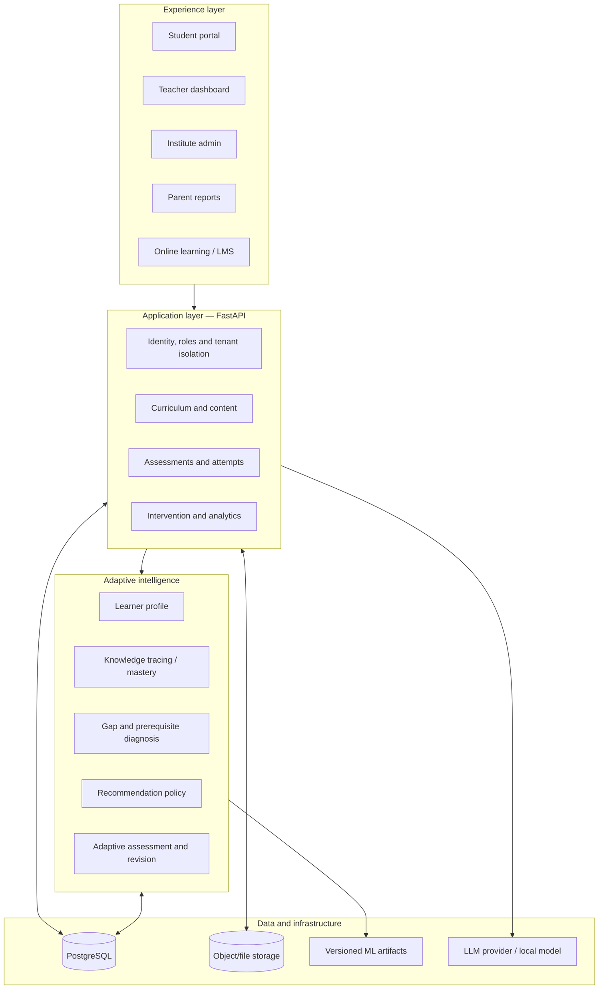

# Pragati 2.0 — Phase-wise Engineering Blueprint

**Purpose:** Upgrade the existing Pragati student-intelligence platform into a commercially viable, adaptive-learning product and a compelling DataNova Global Data-thon 2026 submission.

> **Important implementation rule:** This blueprint is a target design, not a claim that every component already exists. Pragati reportedly has a substantial codebase and database (approximately 31 tables), but the actual repository has not yet been inspected in this conversation. Before changing schemas, models, routes, or folders, map the current implementation and reuse what is sound.

## Confirmed MVP direction

- **Target users:** JEE-coaching institutes, teachers and JEE aspirants in Classes 11 and 12.
- **Subjects:** Physics, Chemistry and Mathematics.
- **Stage 1 — learner profile:** a diagnostic test estimates mastery, confidence, response speed and concept-level gaps; permanent “weak/average/top” labels are avoided.
- **Stage 2 — adaptive path:** each learner receives a goal-, time-, syllabus- and mastery-aware sequence. Weak students receive guided foundation steps, not permanently easy tests.
- **Stage 3 — progress loop:** questions and learning events update mastery and plans; student dashboards and teacher insights show progress, pace, engagement, revision needs and recommended intervention.
- **ASSISTments role:** the downloaded anonymized 2009–2010 interaction log is a behavioral model-development source for attempts, hints, response time and mastery—not the source of JEE questions.
- **JEE content:** build from curriculum-aligned NCERT/official material, rights-reviewed JEEBench items, official NTA/JEE papers or original reviewed questions; never assume public or coaching-institute PDFs are redistributable.
- **Prototype hosting:** Vercel for the frontend, Render for FastAPI, Neon or Supabase for PostgreSQL, and Supabase/Firebase for authentication. Processed/static demo data should run within free-tier limits, with public datasets kept server-side and a cold-start fallback demo.

## Drift corrections (2026-11-05)

Reviewed against the repository and the planning set. The original direction above is kept; these corrections apply on top of it.

- **Response speed and response time for minors.** Stage 1 ("response speed") and the ASSISTments role ("response time") are research-only for under-18 learners until B1 (DPDP s.9(3)) is answered. The product uses correctness-only evidence for minors (D3, B16, ADR-003).
- **JEE item content.** JEEBench is benchmark-only and never student-facing until R11 settles its rights. NTA and JEE Advanced archives wait for written permission. NCERT and Exemplar are reference only. OpenStax is CC BY-NC-SA, so it is excluded from the commercial path. Original and reviewed items are the core source (`data/DATASET_PIPELINE.md`).
- **Hosting.** The Vercel frontend is live (S0). The API host (Render or Vercel functions) is still open (B17).
- **Collaborative filtering and graph algorithms.** The problem brief names both, and the direction above did not. They are added here: collaborative filtering as a benchmark and cold-start fallback, and graph algorithms for prerequisite traversal and bottleneck scoring (B7).
- **Target module names.** The intelligence modules in the target structure map to the engine as: `mastery.py` (knowledge tracing), `graph.py` and `policy.py` (diagnosis and recommendation). Adaptive item selection and revision are not built yet (see the USP below).

## The USP: the adaptive engine, defined so it can be tested

Pragati's differentiator is an adaptive learning path, not a dashboard. The engine must do all of the following. Each item is either built and tested, or marked as not yet built.

| # | Adaptive behaviour | Status (2026-11-05) | Evidence that would show it works |
|---|---|---|---|
| 1 | Chooses the next concept from the prerequisite chain, and explains why | Built (S2, `backend/app/intelligence/policy.py`); E7 passes | E7 (no violations); E4 root-cause agreement with experts |
| 2 | Keeps a learner's state from the evidence, with uncertainty and a guard against lucky guesses | Built as fixed-parameter BKT (S2); not fitted | E3 recovery on an independent simulator; E1 on held-out learners |
| 3 | Chooses the next **item** by difficulty: guided entry for a weak learner, then a deliberate step up toward the target difficulty; no easy-only paths | **Not built** | E9 simulated comparison with a fixed path; E6 teacher ratings |
| 4 | Raises challenge only when evidence supports it, and does not keep raising it after one lucky correct answer | **Not built** | E10 contradictory and guessed runs; E9 |
| 5 | Schedules revision as memory fades (time since last success, errors, prerequisite role) | **Not built** | Retention on a held-out delay; labelled as simulation until a pilot |
| 6 | Uses time, goal and pace to decide what fits the deadline | **Not built** | E9 items-to-mastery under a fixed budget |
| 7 | Shows a benefit over a fixed path, with the comparison pre-registered | **Not run** | E9 (simulation, labelled) then E8 (pilot, randomised) |

**Rule for claims:** until rows 3 to 7 have results, the product may say it chooses the concept adaptively and explains why. It may not say the learning path is adaptive by difficulty or revision, and it may not say adaptation improves learning.

## Product north star

Pragati 2.0 should do more than report how a learner performed. It should determine **what the learner should learn next, why that is the right next step, deliver the learning activity, and measure whether the learner improved**.

The product has two connected capabilities:

1. **Pragati Intelligence** — learner profile, mastery estimation, weak-concept diagnosis, performance insights, teacher interventions and reporting.
2. **Pragati Adaptive** — personalized learning paths, adaptive practice and assessments, revision scheduling, explanations and feedback.

One shared intelligence engine should support multiple education contexts through configuration: coaching, schools, colleges and online learning providers. Do not build separate recommendation engines for each segment.

## Phase index

| Phase | Document | Main outcome |
|---|---|---|
| 0 | `phases/PHASE_0_CODEBASE_AUDIT_AND_PRODUCT_FOUNDATION.md` | Verified baseline, scope, architecture and acceptance criteria |
| 1 | `phases/PHASE_1_DATA_CURRICULUM_AND_CONTENT_FOUNDATION.md` | Reliable curriculum, concept graph, question and resource data |
| 2 | `phases/PHASE_2_ADAPTIVE_INTELLIGENCE_ENGINE.md` | Learner state, knowledge tracing, diagnosis and recommendations |
| 3 | `phases/PHASE_3_ADAPTIVE_LEARNING_EXPERIENCE.md` | Student, teacher and admin experiences connected end-to-end |
| 4 | `phases/PHASE_4_EVALUATION_EXPERIMENTS_AND_TRUST.md` | Defensible evaluation, validation, privacy and reliability |
| 5 | `phases/PHASE_5_HACKATHON_DEMO_AND_SUBMISSION.md` | Polished demo, technical narrative and submission package |
| 6 | `phases/PHASE_6_COMMERCIALIZATION_AND_SCALE.md` | Multi-tenant SaaS and partner/API expansion plan |

## Planning documents added 2026-11-04

| Document | What it is |
|---|---|
| [orchestration/ORCHESTRATOR.md](orchestration/ORCHESTRATOR.md) | Work packages, cloud vs on-computer routing, gates G0 to G5, decision log. Start here to run the project |
| [orchestration/AGENT_PROMPTS.md](orchestration/AGENT_PROMPTS.md) | Self-contained prompts for the audit, legal and licence research, public-data re-run, engine ADRs, simulator |
| [research/RESEARCH_PROMPTS.md](research/RESEARCH_PROMPTS.md) | Ten research prompts (legal, licences, exam scope, hackathon rules, prior art, market, hosting, evaluation priors, Hindi, olympiads) with a findings register |
| [evaluation/EVAL_PLAN.md](evaluation/EVAL_PLAN.md) | Evaluation sets E0 to E14 with origin tags, splits, baselines, proposed pass bars, sample sizes, and a re-map of every existing number |
| [BLOCKERS.md](BLOCKERS.md) | Fourteen blockers (B1 to B14), risks, assumptions, and the decisions the owner must make |
| [PITCH.md](PITCH.md) | Defining user, claims and their evidence status, judge questions, slide outline |
| [PROTOTYPE_PLAN.md](PROTOTYPE_PLAN.md) | Hosted prototype: scope, architecture, stage gates, what the owner must connect |
| [data/DATASET_PIPELINE.md](data/DATASET_PIPELINE.md) | Rights-controlled JEE dataset pipeline and source tiers |

Each phase file now starts with a dated "Update 2026-11-04" block. The original plan text below it is unchanged.

## Suggested target repository structure

This is a **logical target structure**. Do not mechanically move the current repository into it. First map existing folders and preserve working code. Adapt names to the current repo conventions.

```text
pragati/
├── README.md
├── CONTRIBUTING.md
├── .env.example
├── frontend/                         # Existing Next.js application
│   ├── app/
│   │   ├── (auth)/
│   │   ├── (student)/
│   │   ├── (teacher)/
│   │   ├── (admin)/
│   │   └── api/                      # Only if frontend-owned routes are needed
│   ├── components/
│   │   ├── ui/
│   │   ├── student/
│   │   ├── teacher/
│   │   └── analytics/
│   ├── features/
│   │   ├── learning-path/
│   │   ├── assessments/
│   │   ├── mastery/
│   │   └── recommendations/
│   ├── lib/
│   └── tests/
├── backend/                          # Existing FastAPI application
│   ├── app/
│   │   ├── main.py
│   │   ├── core/                     # settings, auth, tenancy, logging
│   │   ├── api/
│   │   │   └── v1/
│   │   ├── modules/
│   │   │   ├── organizations/
│   │   │   ├── users/
│   │   │   ├── learners/
│   │   │   ├── curriculum/
│   │   │   ├── questions/
│   │   │   ├── resources/
│   │   │   ├── assessments/
│   │   │   ├── attempts/
│   │   │   ├── interventions/
│   │   │   └── integrations/
│   │   ├── intelligence/
│   │   │   ├── learner_profile/
│   │   │   ├── knowledge_tracing/
│   │   │   ├── mastery/
│   │   │   ├── diagnosis/
│   │   │   ├── recommendation/
│   │   │   ├── adaptive_assessment/
│   │   │   └── revision/
│   │   ├── genai/
│   │   │   ├── explanations/
│   │   │   ├── question_assistance/
│   │   │   └── reports/
│   │   ├── analytics/
│   │   ├── db/
│   │   │   ├── models/
│   │   │   ├── repositories/
│   │   │   └── migrations/
│   │   └── tests/
│   └── pyproject.toml
├── ml/
│   ├── datasets/
│   │   ├── raw/                      # Git-ignored; licensed data only
│   │   ├── interim/
│   │   └── processed/
│   ├── notebooks/
│   ├── src/
│   │   ├── features/
│   │   ├── training/
│   │   ├── evaluation/
│   │   └── inference/
│   ├── configs/
│   └── artifacts/                    # Versioned metadata; large files external
├── data/
│   ├── curriculum/
│   ├── question_bank/
│   └── demo_fixtures/
├── integrations/
│   ├── csv_import/
│   ├── omr/
│   ├── lms/
│   └── webhooks/
├── docs/
│   ├── architecture/
│   ├── api/
│   ├── data-dictionary/
│   ├── model-cards/
│   ├── privacy/
│   └── decisions/                    # ADRs
├── scripts/
└── infra/
```

## Architecture at a glance



## Non-negotiable engineering principles

- **Audit before editing:** existing 31-table schema and working features must be mapped before migrations.
- **Modular monolith first:** keep the current Next.js + FastAPI + PostgreSQL system cohesive. Split services only when measured scale or team ownership justifies it.
- **Explainability:** every learning recommendation should have a reason that a learner or teacher can understand.
- **Evidence over claims:** separate synthetic simulations, public-dataset experiments and real pilot results.
- **Privacy by design:** minimize student data, protect minors, use consent/appropriate authorization, and do not add invasive engagement tracking.
- **Reproducibility:** record dataset versions, train/test splits, model versions, seeds and evaluation scripts.
- **Fallbacks:** the product must still work if an LLM is unavailable. Core mastery and recommendation logic must not depend on generative AI.
- **Tenant isolation:** no institute or partner may access another organization's learner records.
- **Configurable curriculum:** represent concepts, learning objectives and prerequisites independently from a specific board or exam.

## Public datasets worth evaluating

These are candidate sources, not a mandate to train on every dataset. Check current terms, permitted uses, attribution, redistribution and whether the data is appropriate for the intended population before downloading or commercial use.

| Dataset | What it can help validate | Caveats |
|---|---|---|
| [ASSISTments Data](https://sites.google.com/site/assistmentsdata/) | K-12 math knowledge tracing and next-response prediction | Multiple releases and schemas; inspect skill tags, license/terms and missingness |
| [OULAD](https://analyse.kmi.open.ac.uk/open_dataset) | Online higher-education activity and withdrawal/retention research | Not a direct school-math mastery dataset; avoid equating clicks with learning |
| [EdNet](https://github.com/riiid/ednet) | Large-scale sequential learner interaction and knowledge tracing | Large and behavior-specific; confirm terms and preprocessing |
| [Khan Academy / KDD Cup educational data references](https://pslcdatashop.web.cmu.edu/) | Educational interaction and assessment research | Dataset access and licensing vary by collection |
| [PSLC DataShop](https://pslcdatashop.web.cmu.edu/) | Learning-science datasets, skill models and student interactions | Collection-specific access and use restrictions |
| [OpenStax](https://openstax.org/) | Open educational content and resource mapping | Content license varies by asset; map to local curriculum carefully |
| [NCERT](https://ncert.nic.in/) | Curriculum reference for Indian school content | Check copyright/usage permissions; do not assume all material is open for redistribution |

**Recommended strategy:** use ASSISTments for an initial math knowledge-tracing benchmark, OULAD only for a separate higher-education retention experiment, and your own carefully tagged curriculum/question bank for the product demo. Do not merge incompatible datasets into one training table without an explicit harmonization plan. Public datasets are not automatically licensed for commercial model training or redistribution.

## Definition of a winning product

A strong hackathon submission should demonstrate a complete, testable loop:

1. Two learners start with meaningfully different concept-level knowledge.
2. Each takes a diagnostic assessment.
3. Pragati estimates mastery and uncertainty.
4. It detects prerequisite gaps, not merely the lowest percentage.
5. It recommends different next activities and explains why.
6. Learners attempt practice or learning activities.
7. Their learner states update from the new evidence.
8. The next recommendation changes when justified.
9. A teacher sees the cohort's learning gaps and can review or override interventions.
10. Evaluation compares the adaptive policy against a sensible baseline.

A polished dashboard alone is not enough. The strongest differentiator is **measurable, explainable adaptation**.

## How to use these documents

Work through phases in order, but keep a thin vertical slice running at every stage. Each phase document includes objectives, workstreams, target folders, data/model design, tests, deliverables, risks and exit criteria. Treat all proposed schema and APIs as candidates to reconcile with the existing implementation.
