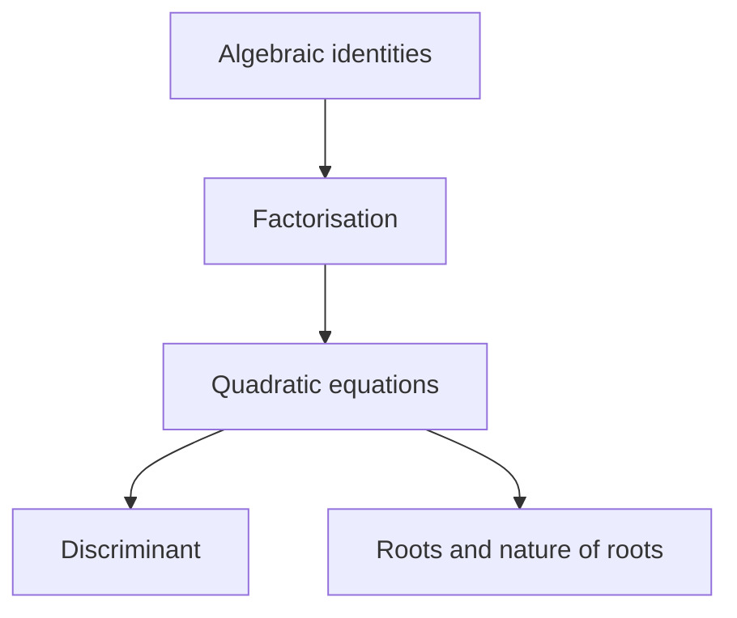
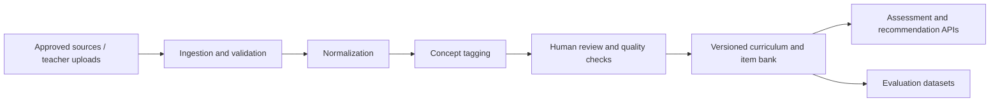

# Phase 1 — Data, Curriculum & Content Foundation

## 1. Purpose

Create a reliable representation of what is taught, how concepts depend on one another, what learning resources exist and how questions measure learning objectives.

The adaptive engine is only as good as its concept tags and evidence. A sophisticated model cannot compensate for incorrect question-to-concept mapping.

**Outcome:** versioned curriculum, concept graph, quality-controlled question bank and learning-resource catalogue.

### JEE MVP data decision

Use ASSISTments only as an anonymized interaction-behavior dataset; the 346,860-row 2009–2010 Skill Builder export does not contain the complete JEE portal's question bank and has no Indian JEE-grade coverage guarantee. The student-facing item bank must separately contain rights-cleared JEE/NCERT-aligned content. Prefer official NCERT/Exemplar, rights-reviewed JEEBench items, official NTA/JEE archive metadata or content, and original peer-reviewed questions. Record source URL, provenance, licence/rights status, syllabus mapping, difficulty and answer verification for every item. Public availability or copying into another GitHub repository is not permission to redistribute.

## 2. Design principles

- Separate the universal learning model from board-, institute- and course-specific configuration.
- A “concept” is not always identical to a textbook chapter or a question tag.
- Support multiple concepts per question, with primary and secondary tags.
- Store source provenance and curriculum version.
- Preserve existing tables where possible; map before migrating.
- Do not scrape or redistribute copyrighted educational material without permission.

## 3. Curriculum model

Suggested hierarchy:

```text
Education system
  └── Curriculum / Program
      └── Curriculum version
          └── Grade / Class / Semester
              └── Subject / Course
                  └── Unit / Chapter / Module
                      └── Learning objective
                          └── Concept / Skill
                              └── Prerequisite concepts
```

This is not a rigid hierarchy. Concepts may be shared across chapters or courses. Use explicit many-to-many mappings where appropriate.

### Suggested logical entities

Reconcile these with the existing 31-table schema before creating anything.

| Entity | Responsibility |
|---|---|
| `education_contexts` | School, college, coaching, online course context |
| `curricula` | Board, program, exam or institution curriculum |
| `curriculum_versions` | Versioned syllabus and effective period |
| `subjects` | Subject/course identity |
| `chapters` | Curriculum grouping |
| `learning_objectives` | Observable outcomes |
| `concepts` | Atomic teachable knowledge units |
| `concept_dependencies` | Directed prerequisite relationships |
| `questions` | Assessment items |
| `question_concepts` | Question-to-concept weights/tags |
| `learning_resources` | Notes, videos, worked examples, external links |
| `resource_concepts` | Resource-to-concept mapping |
| `content_provenance` | Origin, author, license and verification |

### Concept graph rules

- Edge direction must be defined consistently: `prerequisite → dependent concept`.
- Reject cycles unless the graph explicitly supports a different relationship type.
- Store edge type (`prerequisite`, `related`, `extension`) and strength/confidence.
- Add a teacher-review status to imported or AI-suggested edges.
- Support curriculum-specific overrides without corrupting the canonical concept.

Example:



## 4. Question bank quality

Each question should ideally include:

- Stable question ID and version.
- Prompt, options, correct answer and worked solution.
- Question type: MCQ, MSQ, numerical, short answer, etc.
- Difficulty estimate and confidence.
- Concept tags with weights.
- Learning objective.
- Expected time and marks.
- Source and license/provenance.
- Author/reviewer and validation state.
- Language and accessibility metadata.
- Whether the item is safe for adaptive selection and whether it has been exposed in training.

### Tagging workflow

1. Import or create a question.
2. Normalize text and metadata.
3. Suggest concept tags using rules/embeddings/LLM if useful.
4. Validate that suggested tags exist in the selected curriculum.
5. Require human review for low-confidence or high-impact mappings.
6. Run a consistency check against worked solution and expected grade level.
7. Version and publish the item.
8. Monitor item statistics after attempts.

Do not use an LLM's confidence statement as a calibrated probability. Maintain separate model confidence and human approval state.

### Difficulty

Do not assume authored difficulty equals empirical difficulty. Keep fields separate:

- `author_difficulty`: human-assigned category.
- `estimated_difficulty`: model estimate.
- `empirical_difficulty`: estimated from response data.
- `difficulty_confidence`: uncertainty / evidence count.

## 5. Public data and content sources

Use external datasets for research and benchmarking, not as a substitute for the product's own curriculum content.

| Source | Potential use | Recommended treatment |
|---|---|---|
| [ASSISTments Data](https://sites.google.com/site/assistmentsdata/) | Math response sequences and skill-level knowledge tracing | Start here for a focused KT benchmark; inspect release-specific schema and terms |
| [OULAD](https://analyse.kmi.open.ac.uk/open_dataset) | Online higher-ed outcomes and withdrawal prediction | Keep as a separate higher-ed research task; not a Class 10 math substitute |
| [EdNet](https://github.com/riiid/ednet) | Large sequential learning interactions | Consider only after pipeline can handle scale and its data semantics are understood |
| [PSLC DataShop](https://pslcdatashop.web.cmu.edu/) | Learning-science datasets and skill-tagged interactions | Select a collection with suitable access and terms |
| [OpenStax](https://openstax.org/) | Open textbooks and resource mapping | Verify license per content and preserve attribution |
| [NCERT](https://ncert.nic.in/) | Indian school curriculum alignment | Use as curriculum reference; verify permissions before reproducing content |

Before any dataset enters training, create `ml/datasets/README.md` recording:
- Dataset name, version and download date.
- Official source URL and license/terms checked.
- Allowed purpose (research, internal evaluation, commercial use, redistribution).
- Fields used and excluded.
- Personal/sensitive data assessment.
- Preprocessing steps and checksums.
- Known bias and population mismatch.

Never put raw datasets in Git. Use a controlled data directory or approved object storage.

## 6. Data pipeline



Suggested folder structure:

```text
data/
├── curriculum/
│   ├── schemas/
│   ├── class_10_math/
│   └── versions/
├── question_bank/
│   ├── imports/
│   ├── normalized/
│   ├── reviewed/
│   └── manifests/
└── demo_fixtures/
    ├── learners/
    ├── assessments/
    └── expected_paths/

backend/app/modules/curriculum/
├── models.py
├── schemas.py
├── repository.py
├── service.py
├── validators.py
└── tests/

backend/app/modules/questions/
├── models.py
├── schemas.py
├── tagging/
├── quality/
├── repository.py
├── service.py
└── tests/
```

## 7. Data validation and tests

- No orphan question-concept mappings.
- No prerequisite cycles in the active graph.
- Every published question has an approved curriculum version and at least one valid concept tag.
- Every resource has provenance and a usage permission record.
- Concept IDs remain stable across curriculum version changes where meaning is unchanged.
- Imports are idempotent; retrying an import does not duplicate records.
- Validate language, encoding, missing answers and malformed question options.
- Create a small manually reviewed gold set to measure tagging precision/recall.

## 8. Deliverables

- Curriculum schema and data dictionary.
- One complete demo curriculum (Class 10 Mathematics — Quadratic Equations).
- Concept/prerequisite graph with teacher-reviewed edges.
- Question bank with validated tags, solutions and difficulty metadata.
- Resource catalogue mapped to concepts.
- Dataset provenance and licensing register.
- Import scripts and automated quality checks.

## 9. Exit criteria

- [ ] A learner's course can be resolved to a curriculum version.
- [ ] Each demo question maps to valid concept IDs.
- [ ] Prerequisites can be traversed deterministically.
- [ ] Content provenance and permission status are recorded.
- [ ] Tagging quality is measured on a reviewed sample.
- [ ] Existing data is migrated only through tested, reversible migrations.

**Gate:** do not train or evaluate knowledge tracing until event/response records have stable learner, item, concept and timestamp semantics.
