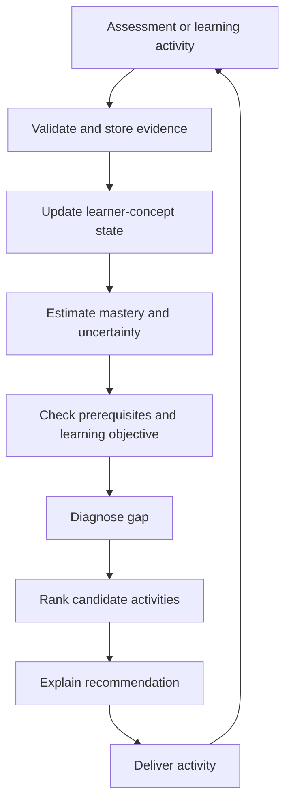

# Phase 2 — Adaptive Intelligence Engine

## 1. Purpose

Build the decision-making core that estimates what a learner knows, diagnoses what is blocking progress and selects the next best learning activity.

**Outcome:** a testable, explainable adaptive loop that updates learner state after each valid learning event.

### Personalization model for JEE aspirants

The initial diagnostic creates a concept-level profile rather than a permanent weak/average/top label. Each recommendation considers current mastery, mastery uncertainty, response time, hint dependency, exam goal, target date, syllabus, available study hours, prerequisites and revision history. The algorithm must give a weaker learner guided entry questions, then deliberately increase challenge toward the target JEE difficulty; easy-only paths are prohibited. When difficulty distributions between students differ, compare common concept benchmarks and absolute mastery improvement rather than judging students by unequal tests alone.

## 2. Core loop



## 3. Learner state

Maintain a state per learner and concept, with enough metadata to explain and reproduce decisions.

Suggested logical fields:

- learner ID and tenant ID.
- concept ID and curriculum version.
- mastery estimate (normalized, with defined semantics).
- uncertainty or confidence interval.
- evidence count and last evidence timestamp.
- recent response trend.
- estimated difficulty exposure.
- model/policy version.
- state update timestamp.

Do not present a mastery estimate as an objective truth. Show it as an estimate supported by available evidence. Avoid false precision such as 73.42% unless the model and calibration justify it.

## 4. Knowledge tracing options

Start with interpretable baselines. Compare methods rather than choosing the most complex model.

### 4.1 Baseline rules

A simple baseline can update mastery from correctness, item difficulty and concept weights. It is useful as a benchmark and fallback, but should not be described as a validated knowledge-tracing model.

### 4.2 Bayesian Knowledge Tracing (BKT)

BKT models whether a learner has mastered a skill using latent states and response evidence. Typical parameters:

- `P(L0)`: prior probability of mastery.
- `P(T)`: probability of learning after an opportunity.
- `P(G)`: probability of a correct answer despite not mastering (guess).
- `P(S)`: probability of an incorrect answer despite mastery (slip).

For a correct response:

\[
P(L \mid correct)=
\frac{P(L)(1-P(S))}
{P(L)(1-P(S))+(1-P(L))P(G)}
\]

For an incorrect response:

\[
P(L \mid incorrect)=
\frac{P(L)P(S)}
{P(L)P(S)+(1-P(L))(1-P(G))}
\]

Then apply the learning transition:

\[
P(L_{t+1})=P(L_t \mid response)+(1-P(L_t \mid response))P(T)
\]

Document assumptions, parameter fitting and whether parameters are global, skill-specific or learner-specific. Avoid fitting unstable parameters on tiny samples.

### 4.3 IRT / Rasch

Use item-response models when item difficulty and learner ability are supported by enough response data. Keep item difficulty calibration separate from concept mastery. A question can assess multiple concepts, and a single total score is not a complete concept profile.

### 4.4 Deep Knowledge Tracing (DKT)

Treat DKT as an experimental option, not an MVP dependency. It requires sequential data, careful split design, calibration checks and explainability work. Only adopt it if it beats simpler baselines on held-out learners and improves downstream recommendations.

## 5. Gap diagnosis

Diagnosis should consider more than the smallest mastery score:

1. Is the concept required for the learner's current objective?
2. Are its prerequisites sufficiently mastered?
3. Is the estimate supported by enough evidence?
4. Is the gap recent or persistent?
5. Does the question evidence isolate this concept?
6. Is there an available, suitable learning resource?
7. Would another diagnostic question reduce uncertainty?

Example: a learner's discriminant score may be lowest, but factorisation is a prerequisite and also weak. Recommend factorisation first rather than blindly selecting the lowest percentage.

Represent diagnosis output with:
- `gap_type`: prerequisite, direct concept, retention, confidence/insufficient evidence.
- `affected_concept_ids`.
- `evidence_event_ids`.
- `severity` and `uncertainty`.
- `reason_codes` and learner-friendly explanation.

## 6. Recommendation policy

Build a transparent scoring policy first. Candidate activities can include:

- Review prerequisite concept.
- Read/watch a mapped explanation.
- Study a worked example.
- Attempt guided practice.
- Attempt independent practice.
- Take a diagnostic question.
- Revise a previously learned concept.

Possible ranking factors:

\[
Score(a)=w_1G(a)+w_2P(a)+w_3U(a)+w_4R(a)+w_5F(a)-w_6C(a)
\]

Where:
- `G`: relevance to diagnosed gap.
- `P`: prerequisite readiness / priority.
- `U`: uncertainty reduction value.
- `R`: resource suitability and availability.
- `F`: forgetting/retention urgency.
- `C`: estimated cognitive/time cost.

Normalize factors, document weights and run sensitivity tests. Do not hard-code weights without evaluation. Include constraints: grade-level suitability, curriculum alignment, already-completed activities, accessibility and teacher overrides.

### Explainability contract

Every recommendation should return:
- What to do next.
- Target concept and objective.
- Why this was selected.
- Evidence used (human-readable, permission-aware).
- Expected effort or duration if known.
- What success looks like.
- Policy/model version.

Example: “Review factorisation first. Your recent answers show difficulty with factorising expressions, which is needed to solve the quadratic equations in your next activity.”

## 7. Adaptive assessment

Select the next question to balance:
- Concept coverage.
- Estimated difficulty.
- Information value / uncertainty reduction.
- Avoiding repeated exposure.
- Assessment blueprint and teacher constraints.
- Fairness and accessibility.

Do not simply keep increasing difficulty after a correct answer. A learner may guess, have a narrow concept gap or need prerequisite reinforcement. Use stopping rules and maximum assessment length.

## 8. Revision and retention

A basic revision scheduler can prioritize concepts based on:
- Time since last successful retrieval.
- Mastery estimate and uncertainty.
- Recent errors.
- Importance to current course objectives.
- Prerequisite role.

Treat spaced-repetition intervals as a configurable policy and evaluate them. Do not claim a universal forgetting curve from a small demo.

## 9. Suggested module structure

```text
backend/app/intelligence/
├── contracts/
│   ├── learner_state.py
│   ├── evidence.py
│   ├── diagnosis.py
│   └── recommendation.py
├── learner_profile/
│   ├── service.py
│   └── tests/
├── knowledge_tracing/
│   ├── base.py
│   ├── rule_baseline.py
│   ├── bkt.py
│   ├── irt_adapter.py
│   ├── model_registry.py
│   └── tests/
├── mastery/
│   ├── estimator.py
│   └── calibration.py
├── diagnosis/
│   ├── prerequisite_analyzer.py
│   ├── gap_detector.py
│   └── tests/
├── recommendation/
│   ├── candidate_generator.py
│   ├── ranker.py
│   ├── explanation.py
│   └── tests/
├── adaptive_assessment/
│   ├── selector.py
│   └── constraints.py
└── revision/
    ├── scheduler.py
    └── tests/

ml/
├── src/training/
├── src/evaluation/
├── src/inference/
├── configs/
└── artifacts/
```

## 10. API contracts (proposed)

Adapt route conventions and authentication to the existing API.

```http
POST /api/v1/learners/{learner_id}/events
GET  /api/v1/learners/{learner_id}/mastery
GET  /api/v1/learners/{learner_id}/diagnosis
GET  /api/v1/learners/{learner_id}/next-step
GET  /api/v1/learners/{learner_id}/learning-path
POST /api/v1/assessments/{assessment_id}/attempts
POST /api/v1/assessments/adaptive
POST /api/v1/recommendations/{recommendation_id}/feedback
```

Use idempotency keys for event/attempt submission. Validate tenant ownership on every learner, assessment, question and resource access.

## 11. Tests and evaluation

- Unit tests for BKT updates and boundary conditions.
- Replay tests: same ordered events and same model version produce same learner state.
- No future data leakage in state updates.
- Recommendation tests for prerequisite ordering and grade constraints.
- Cold-start tests with no evidence.
- Sparse-data and contradictory-evidence tests.
- Calibration tests and confidence reporting.
- Compare rule baseline, BKT and existing IRT/Rasch approach.
- Evaluate on held-out learners, not random rows from the same learner.
- Track next-response AUC/log loss, calibration, recommendation relevance, prerequisite violation rate and learning gain.

## 12. Exit criteria

- [ ] Learner state updates from validated attempts.
- [ ] Mastery output includes evidence/uncertainty semantics.
- [ ] Prerequisite-aware diagnosis works on the demo graph.
- [ ] Recommendation policy returns a reason and version.
- [ ] Student receives different paths when evidence differs.
- [ ] A new attempt can change the next recommendation.
- [ ] Baseline and BKT are compared on an appropriate dataset.
- [ ] Fallback works when LLM is unavailable.

**Gate:** the adaptive loop must work deterministically with rules before adding more complex models or autonomous agents.
